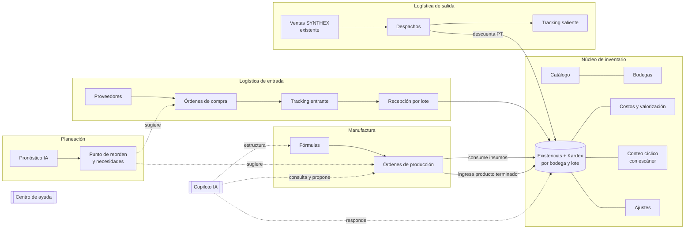
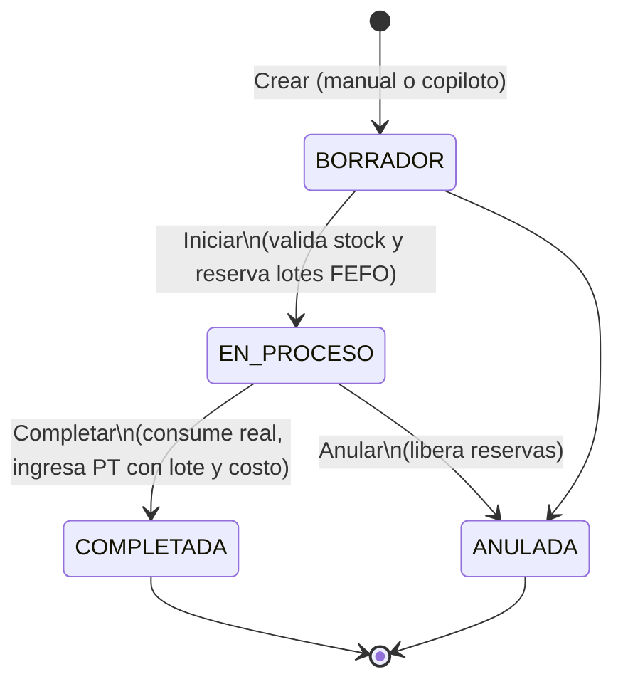
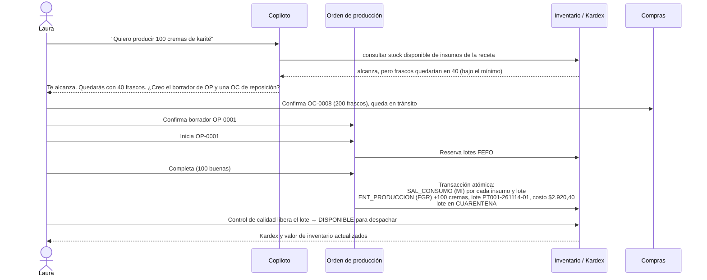
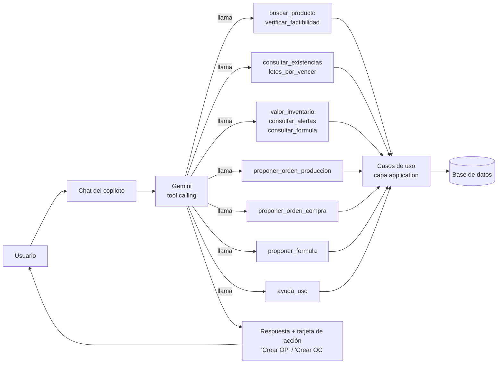
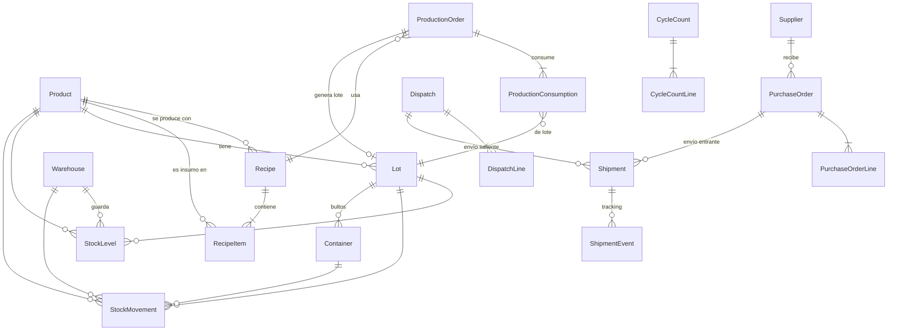

# SYNTHEX · Manufactura e Inventario para Cosmética Natural

> Primera experiencia de manufactura integrada al módulo de inventario de SYNTHEX, diseñada para PyMEs latinoamericanas que **transforman insumos en productos terminados**. Caso de estudio: un laboratorio colombiano de cosmética natural.

| Entregable | Enlace |
|---|---|
| Demo funcional con IA | https://prueba-inventariof.vercel.app/ |
| Video (máx. 8 min) | _pendiente: URL del video_ |
| Repositorio | este repositorio |

**Estado:** la Fase 1 está construida y probada (ver [§13](#13-qué-incluye-el-demo-y-qué-queda-para-después) y [§17](#17-recorrido-sugerido-del-demo)). Está desplegada en Vercel (región São Paulo) con base de datos en Supabase ([§16](#16-ejecución-local-y-despliegue)).

---

## Índice

1. [El problema y a quién le resolvemos](#1-el-problema-y-a-quién-le-resolvemos)
2. [Caso de negocio: "Botánica Viva"](#2-caso-de-negocio-botánica-viva)
3. [Supuestos explícitos](#3-supuestos-explícitos)
4. [Referentes de mercado: qué conceptos tomamos](#4-referentes-de-mercado-qué-conceptos-tomamos)
5. [Glosario](#5-glosario)
6. [Mapa de módulos y priorización](#6-mapa-de-módulos-y-priorización)
7. [Detalle de módulos y requerimientos](#7-detalle-de-módulos-y-requerimientos)
8. [Cómo se conecta la manufactura con el inventario](#8-cómo-se-conecta-la-manufactura-con-el-inventario)
9. [Costos: cómo se calculan](#9-costos-cómo-se-calculan)
10. [Copiloto IA](#10-copiloto-ia)
11. [Modelo de datos](#11-modelo-de-datos)
12. [Arquitectura y stack](#12-arquitectura-y-stack)
13. [Qué incluye el demo y qué queda para después](#13-qué-incluye-el-demo-y-qué-queda-para-después)
14. [Métricas de éxito](#14-métricas-de-éxito)
15. [Riesgos y preguntas abiertas](#15-riesgos-y-preguntas-abiertas)
16. [Ejecución local y despliegue](#16-ejecución-local-y-despliegue)
17. [Recorrido sugerido del demo](#17-recorrido-sugerido-del-demo)

---

## 1. El problema y a quién le resolvemos

### Situación actual
SYNTHEX ya permite **crear productos, controlar existencias y consultar movimientos**. Pero muchos clientes no solo compran y venden: **transforman**. Hoy llevan esa transformación en hojas de cálculo o cuadernos, por fuera del sistema. Eso provoca:

| Dolor | Consecuencia para el negocio |
|---|---|
| El stock de insumos en SYNTHEX no baja cuando se produce | El inventario del sistema deja de ser confiable; se hacen conteos manuales constantes |
| El producto terminado "aparece" sin origen | No se sabe cuánto costó fabricarlo; el precio de venta se fija "a ojo" |
| Las fórmulas viven en un cuaderno | Se pierden, cambian sin control y cada operario produce distinto |
| No hay trazabilidad por lote | Ante un reclamo o una visita del INVIMA no se puede saber qué insumos usó un lote |
| Las compras se hacen cuando "ya se acabó" | Producción parada mientras se espera al proveedor |
| No se sabe qué viene en camino ni qué se despachó | Se duplican pedidos y se pierden entregas |

### Usuario objetivo (persona)

**Laura, 34 años, fundadora de una marca de cosmética natural en Medellín.**
- Equipo de 6 a 12 personas: ella, 2 o 3 operarias de producción, 1 persona de bodega y despachos, 1 asistente administrativa.
- Vende por su tienda online, marketplaces y a 15 tiendas naturistas (canal B2B).
- Produce **por lotes** (de 50 a 300 unidades) unas 8 a 15 veces al mes.
- Maneja unos **40 insumos** (aceites, mantecas, activos, envases, etiquetas) y unos **12 productos terminados**.
- Ya usa SYNTHEX para facturar y llevar su inventario de producto terminado.
- **Lo que quiere:** "saber cuánto me cuesta cada crema, no quedarme sin insumos y poder responderle al INVIMA qué tiene cada lote".

**Usuarios secundarios:** la operaria de producción (ejecuta órdenes y registra lo que consume), la persona de bodega (recibe compras, cuenta y despacha) y la asistente administrativa (compras y proveedores).

### Promesa de valor
> **"Del insumo que llega al producto que sale, todo en un solo lugar: cuánto tienes, cuánto te cuesta, de qué lote viene y cuándo debes volver a comprar."**

---

## 2. Caso de negocio: "Botánica Viva"

Empresa ficticia que usamos en el demo (datos semilla).

**Por qué cosmética natural:** muestra todo lo que un módulo de manufactura tiene que resolver (varias unidades de medida, lotes obligatorios, vencimientos, empaques y costos sensibles), y aun así se explica en un minuto: *"mezclo aceites y mantecas, lo envaso, lo etiqueto y lo vendo"*.

### Bodegas
| Código | Bodega | Uso |
|---|---|---|
| BOD-MP | Materias primas | Aceites, mantecas, activos, conservantes |
| BOD-EMP | Material de empaque | Frascos, tapas, etiquetas, cajas |
| BOD-PT | Producto terminado | Listo para vender y despachar |

### Catálogo semilla (extracto)
| SKU | Producto | Tipo | Unidad | Lote / vence |
|---|---|---|---|---|
| MP-001 | Manteca de karité | Materia prima | kg | Sí |
| MP-002 | Aceite de almendras | Materia prima | L | Sí |
| MP-003 | Cera emulsionante | Materia prima | kg | Sí |
| MP-004 | Glicerina vegetal | Materia prima | L | Sí |
| MP-005 | Vitamina E | Materia prima | L | Sí |
| MP-006 | Conservante natural | Materia prima | kg | Sí |
| MP-007 | Aceite esencial de lavanda | Materia prima | L | Sí |
| MP-008 | Agua desmineralizada | Materia prima | L | No |
| EMP-001 | Frasco ámbar 50 g | Empaque | unidad | No |
| EMP-002 | Tapa rosca negra | Empaque | unidad | No |
| EMP-003 | Etiqueta crema karité | Empaque | unidad | No |
| PT-001 | Crema hidratante de karité 50 g | Producto terminado | unidad | Sí |
| PT-002 | Bálsamo labial 10 g | Producto terminado | unidad | Sí |
| PT-003 | Jabón artesanal de avena 100 g | Producto terminado | unidad | Sí |
| PT-004 | Serum facial vitamina C 30 ml | Producto terminado | unidad | Sí |

---

## 3. Supuestos explícitos

El reto permite asumir características del negocio si se hacen explícitas. Estas son las nuestras:

| # | Supuesto | Por qué |
|---|---|---|
| S1 | El negocio opera en **Colombia**: moneda **COP** y **IVA 19%** | Caso concreto y fácil de defender |
| S2 | La empresa es **responsable de IVA**: el IVA de las compras es descontable y **no forma parte del costo** del inventario | Es el caso más común en PyMEs formales |
| S3 | El costo se valora con **promedio ponderado** | Es el método más usado y entendido en PyMEs de LatAm; es simple de auditar |
| S4 | Se produce **por lotes**, no unidad a unidad | Así trabaja la cosmética artesanal; la receta define un **lote estándar** (ej. 100 unidades) |
| S5 | Todo insumo químico y todo producto terminado lleva **lote y fecha de vencimiento** | La normativa andina de cosméticos exige el lote en la etiqueta, y la trazabilidad es crítica ante reclamos |
| S6 | Los productos tienen **Notificación Sanitaria Obligatoria (NSO)** del INVIMA, que se registra como dato del producto | El sistema no gestiona el trámite, solo guarda la referencia |
| S7 | El módulo de **ventas/facturación ya existe** en SYNTHEX; este módulo **consume** sus ventas (para el histórico) y **despacha** sus pedidos | El reto indica integrarse a lo existente, no reemplazarlo |
| S8 | **Costeo directo de materiales**: el costo de producción es la suma de insumos y empaques consumidos. Mano de obra y costos indirectos (CIF) quedan para una fase posterior | Mantiene el MVP explicable sin perder lo esencial |
| S9 | En el MVP hay **un solo usuario administrador**; los roles llegan en Fase 3 | Reduce complejidad del demo |
| S10 | En el MVP el estado del envío se actualiza **a mano**. Cada transportadora tiene una **plantilla de URL de rastreo** y, al hacer clic en la guía, se abre la página oficial con la guía cargada; si la transportadora no acepta la guía en la URL, se abre su página de rastreo y la guía se copia al portapapeles. La **sincronización automática** del estado real (ej. pasar solo a "Entregado") queda para la **Fase 2** | La sincronización exige integraciones oficiales (contrato y credenciales) o un servicio que agrupe transportadoras. Descartamos el *scraping* por frágil (cambios en la página, CAPTCHA, bloqueos desde la nube) y por los términos de uso de los sitios |
| S11 | La empresa ficticia "Botánica Viva" y todas sus cifras son **datos de ejemplo** | Escenario ficticio del reto |

---

## 4. Referentes de mercado: qué conceptos tomamos

Revisamos el enfoque de suites ERP con módulo de manufactura (p. ej. Odoo), herramientas de manufactura para PyMEs (p. ej. Katana, MRPeasy) y sistemas de inventario (p. ej. Zoho Inventory). **No replicamos ninguna**: identificamos los conceptos que comparten y los adaptamos a una PyME que hoy usa un cuaderno.

| Concepto común en el mercado | Cómo lo adaptamos | Qué evitamos a propósito |
|---|---|---|
| Lista de materiales (BOM) | "Fórmula" de un solo nivel con rendimiento por lote | Rutas de trabajo, centros de trabajo, multinivel y versiones (Fase 2) |
| Orden de fabricación | "Orden de producción" con 4 estados simples | Planificación por capacidad de máquinas |
| Trazabilidad por lote y número de serie | Lote obligatorio para químicos y producto terminado; series no | Números de serie (no aplican a cosméticos) |
| Reglas de reabastecimiento (mín/máx) | Punto de reorden calculado con pronóstico IA | MRP completo con tiempos de proveedor encadenados |
| Valoración de inventario (FIFO / promedio) | Promedio ponderado (S3) | Elegir método por producto |
| Conteo cíclico | Conteo con escáner por sesión y clasificación ABC | Inventario perpetuo por ubicación fina (estante/nivel) |
| Costo en destino (landed cost) | Documentado para Fase 2 | — |

**Diferencial de nuestra propuesta:** un **copiloto en lenguaje natural** que responde la pregunta que Laura realmente se hace ("¿me alcanza para producir 200 cremas?") y deja la orden lista con un clic, más la ayuda integrada para alguien que nunca ha usado un software de manufactura.

---

## 5. Glosario

| Término | Definición en SYNTHEX |
|---|---|
| **Insumo / Materia prima** | Lo que se consume para fabricar (aceites, mantecas, activos) |
| **Material de empaque** | Insumo que no entra en la mezcla (frasco, tapa, etiqueta). Se trata igual que una materia prima |
| **Producto terminado** | Lo que se vende |
| **Fórmula (receta / BOM)** | Lista de insumos y cantidades para producir un **lote estándar**. En pantalla se llama "Fórmula", como se dice en cosmética |
| **Lote estándar / rendimiento** | Cuántas unidades produce la receta (ej. 100 cremas) |
| **Orden de producción (OP)** | Instrucción de fabricar X unidades de un producto con una receta |
| **Lote (batch)** | Grupo de unidades con mismo origen y fecha; tiene código y vencimiento |
| **Bulto / serial** | Recipiente físico (saco, garrafa, caja) con una etiqueta de código de barras única. Contiene un solo producto de un solo lote |
| **FEFO** | *First Expired, First Out*: se usa primero lo que vence antes |
| **Kardex** | Historial cronológico de entradas y salidas por producto, con costo |
| **Costo promedio ponderado** | Costo unitario = valor total del inventario ÷ cantidad total |
| **Stock disponible** | Físico − reservado − en cuarentena |
| **Stock en tránsito** | Comprado y despachado por el proveedor, aún no recibido |
| **Punto de reorden (ROP)** | Nivel de stock en el que se debe comprar o producir |
| **Stock de seguridad** | Colchón para cubrir variaciones de demanda o retrasos |
| **Cobertura (días)** | Cuántos días alcanza el stock con la demanda proyectada |
| **Conteo cíclico** | Contar una parte del inventario de forma periódica, en vez de todo una vez al año |
| **Clasificación ABC** | A = pocos ítems con mucho valor (se cuentan más seguido); C = muchos ítems con poco valor |

---

## 6. Mapa de módulos y priorización



### Priorización

**Fase 1 (MVP / Demo)** se construye en los 4 días. **Fase 2** y **Fase 3** quedan especificadas en este documento.

| # | Módulo | Fase | ¿En el demo? |
|---|---|---|---|
| M1 | Catálogo de productos | 1 | ✅ |
| M2 | Bodegas y traslados | 1 | ✅ |
| M3 | Existencias y Kardex | 1 | ✅ |
| M4 | Costos y valorización | 1 | ✅ |
| M5 | Lotes y vencimientos | 1 | ✅ |
| M5.1 | Etiquetas con código de barras y seriales por bulto | 1 | ✅ |
| M6 | Proveedores y órdenes de compra | 1 | ✅ |
| M7 | Tracking de envíos entrantes | 1 | ✅ |
| M8 | Fórmulas (receta / BOM) | 1 | ✅ |
| M9 | Órdenes de producción | 1 | ✅ |
| M10 | Conteo cíclico con escáner | 1 | ✅ |
| M11 | Ajustes de inventario | 1 | ✅ |
| M12 | Despachos y tracking saliente | 1 | ✅ |
| M13 | Copiloto IA | 1 | ✅ |
| M14 | Centro de ayuda e instrucciones de uso | 1 | ✅ |
| M15 | Tablero y alertas | 1 (básico) / 2 | ✅ básico |
| M16 | Planeación: pronóstico IA, reorden y necesidades | 2 | 📄 documentado |
| M17 | Usuarios, roles y auditoría | 3 | 📄 documentado |

---

## 7. Detalle de módulos y requerimientos

Convenciones: **RF** = requerimiento funcional · **RN** = regla de negocio · **CA** = criterio de aceptación · **HU** = historia de usuario.

### M1 · Catálogo de productos

**Objetivo:** un solo catálogo donde cada ítem dice qué es (insumo, empaque, terminado), cómo se mide y cómo se controla.

**HU-1.1** Como Laura, quiero registrar mis insumos y productos con su unidad de medida para que las recetas y el stock hablen el mismo idioma.

| ID | Requerimiento |
|---|---|
| RF-1.1 | Crear, editar, archivar productos con: SKU (único), nombre, categoría, tipo (`MATERIA_PRIMA`, `EMPAQUE`, `PRODUCTO_TERMINADO`; `INTERMEDIO` llega en Fase 2 con las fórmulas multinivel), unidad base, código de barras (EAN-13 / Code128 / interno) |
| RF-1.2 | Definir si el producto **controla lote** y si **controla vencimiento**; vida útil en días (para calcular el vencimiento automáticamente al producir) |
| RF-1.3 | Unidades de compra distintas a la unidad base, con factor de conversión (ej. compro "garrafa 20 L" = 20 L) |
| RF-1.4 | Datos regulatorios del producto terminado: número de NSO INVIMA y su vencimiento |
| RF-1.5 | Parámetros de inventario: stock mínimo, stock de seguridad, tiempo de reposición (días), proveedor preferido |
| RF-1.6 | Precio de venta (lectura desde el catálogo existente de SYNTHEX) para calcular margen |
| RF-1.7 | Etiquetas con código de barras por SKU y seriales por bulto: ver [M5.1](#m51--etiquetas-con-código-de-barras-y-seriales-por-bulto) |
| RN-1.1 | El SKU y el código de barras son únicos por empresa |
| RN-1.2 | No se puede eliminar un producto con movimientos; solo archivar |
| RN-1.3 | La unidad base no se puede cambiar si el producto ya tiene movimientos |
| CA-1.1 | Al crear "Manteca de karité" en kg con lote y vencimiento activos, aparece en el selector de insumos de las recetas |

### M2 · Bodegas y traslados

**Objetivo:** saber **dónde** está cada cosa y moverla entre lugares sin perder trazabilidad.

| ID | Requerimiento |
|---|---|
| RF-2.1 | CRUD de bodegas: código, nombre, tipo (materias primas, empaque, producción, producto terminado), activa/inactiva. La cuarentena es un **estado del lote**, no una bodega: el lote no se mueve físicamente para quedar en cuarentena |
| RF-2.2 | Bodega por defecto por tipo de producto (recepciones de MP llegan a BOD-MP, producción entrega a BOD-PT) |
| RF-2.3 | Traslado entre bodegas: producto, lote, cantidad, origen, destino. Genera dos movimientos (salida + entrada) con la misma referencia |
| RN-2.1 | Un traslado no cambia el costo promedio (solo ubicación) |
| RN-2.2 | No se puede trasladar más que el disponible del lote en la bodega origen |
| CA-2.1 | Tras trasladar 2 kg de karité de BOD-MP a una bodega de producción, el Kardex muestra ambos movimientos y el total de la empresa no cambia |

### M3 · Existencias y Kardex

**Objetivo:** fuente única de verdad del stock, con historial inmutable.

| ID | Requerimiento |
|---|---|
| RF-3.1 | Vista de existencias por producto con desglose por bodega, lote y bulto (serial): físico, reservado, en cuarentena, disponible, en tránsito, valor. **Desde cualquier saldo se llega en un clic a los movimientos que lo explican** y de ahí al documento que los originó |
| RF-3.2 | Kardex por producto: fecha y hora, tipo de movimiento (nombre y sigla), documento soporte (OC, OP, REM, AJ, CC, TR), **número de remisión** (remisión de entrega en las salidas a clientes; remisión del proveedor en las entradas por compra), tercero (proveedor o cliente), bodega, lote, serial, entrada, salida, saldo, costo unitario, costo promedio resultante, valor del saldo y usuario |
| RF-3.3 | Filtros por fecha, bodega, lote, serial, tipo de movimiento, documento, remisión y tercero; exportar a CSV/Excel |
| RF-3.4 | Semáforo de stock: rojo (≤ seguridad), amarillo (≤ mínimo), verde |
| RF-3.5 | **Trazabilidad completa de cada movimiento.** Cada movimiento registra siempre: consecutivo, fecha y hora, usuario, tipo, documento soporte (tipo, número y enlace), remisión cuando aplica, tercero, producto, lote, serial(es), bodega origen y destino, cantidad y unidad, costo unitario, costo promedio y saldo **antes y después**, motivo y movimiento relacionado (la otra mitad de un traslado o el movimiento que se reversa) |
| RF-3.6 | Vista de detalle de movimiento con toda su cadena: documento soporte → lote → bultos → movimientos anteriores y posteriores del mismo lote |
| RN-3.1 | **Los movimientos son inmutables.** Un error se corrige con un movimiento inverso (ajuste o reverso) que referencia al original, nunca editando ni borrando |
| RN-3.2 | Todo cambio de stock ocurre **solo** a través de un movimiento; no existe "editar stock" directo |
| RN-3.3 | Por defecto no se permite stock negativo (configurable a futuro) |
| RN-3.4 | **No existe un movimiento sin documento soporte.** Si un dato obligatorio de trazabilidad falta (lote en un producto que lo controla, remisión en una salida a cliente, motivo en un ajuste), el movimiento no se guarda |
| CA-3.1 | Desde el saldo de 112 cremas se abre el Kardex; al hacer clic en la salida de 24 u se ve la remisión REM-0003, el cliente, el lote, los seriales de las cajas, la guía y quién la registró |

**Convención de códigos:** todos los códigos de estados, tipos de producto y tipos de movimiento están en español, porque es una PyME colombiana. En los movimientos y documentos se agrega la sigla internacional de logística.

**Tipos de movimiento.** Se muestran en español, con la sigla internacional de logística entre paréntesis. Así el usuario los entiende y el equipo técnico, los proveedores y las integraciones hablan el mismo idioma.

| Código | Movimiento | Sigla internacional | Significado de la sigla | Signo | Documento soporte |
|---|---|---|---|---|---|
| `ENT_COMPRA` | Entrada por compra | **GR** | Goods Receipt | + | OC + remisión del proveedor |
| `ENT_PRODUCCION` | Entrada por producción | **FGR** | Finished Goods Receipt | + | OP |
| `SAL_CONSUMO` | Consumo de producción | **MI** | Material Issue | − | OP |
| `SAL_VENTA` | Salida por venta (despacho) | **GI** | Goods Issue | − | REM (remisión de entrega) |
| `TRASLADO_SAL` / `TRASLADO_ENT` | Traslado entre bodegas | **STO** | Stock Transfer Order | − / + | TR |
| `AJUSTE_ENT` / `AJUSTE_SAL` | Ajuste de inventario (manual o por conteo) | **ADJ** | Inventory Adjustment | + / − | AJ o CC |
| `BAJA` | Baja por merma, vencimiento o daño | **SCR** | Scrap / Write-off | − | AJ |
| `INV_INICIAL` | Inventario inicial | **OB** | Opening Balance | + | AJ |
| `DEV_CLIENTE` | Devolución de cliente (Fase 2) | **RMA** | Return Merchandise Authorization | + | REM original |
| `DEV_PROVEEDOR` | Devolución a proveedor (Fase 2) | **RTV** | Return to Vendor | − | OC original |

**Documentos soporte.**

| Sigla | Documento | Sigla internacional |
|---|---|---|
| OC | Orden de compra | PO (Purchase Order) |
| OP | Orden de producción | MO (Manufacturing Order) |
| REM | Remisión de entrega (despacho a cliente) | DN (Delivery Note) |
| — | Remisión del proveedor (se registra su número al recibir) | ASN / DN del proveedor |
| AJ | Ajuste de inventario | ADJ |
| CC | Conteo cíclico | CC (Cycle Count) |
| TR | Traslado | STO (Stock Transfer Order) |

### M4 · Costos y valorización

**Objetivo:** que Laura sepa **cuánto vale su inventario** y **cuánto le cuesta cada unidad** que produce.

| ID | Requerimiento |
|---|---|
| RF-4.1 | Costo unitario promedio ponderado por producto, recalculado en cada entrada con costo (compra, producción, ajuste positivo) |
| RF-4.2 | Valor del inventario total, por bodega, por categoría y por tipo de producto |
| RF-4.3 | Costo de producción de cada OP: teórico (según receta) vs real (según consumos reales), con variación |
| RF-4.4 | Costo unitario del producto terminado = costo real de la OP ÷ unidades buenas producidas |
| RF-4.5 | Costeo de receta en vivo: al editar una receta se muestra su costo por lote y por unidad con los costos promedio actuales |
| RF-4.6 | Margen bruto estimado por producto terminado = precio de venta − costo unitario |
| RF-4.7 | Historial de costo unitario por producto (gráfica) |
| RN-4.1 | Las salidas (consumo, venta, merma) se valoran al **costo promedio vigente** y no lo modifican |
| RN-4.2 | El IVA descontable no se suma al costo (S2) |
| RN-4.3 | Los costos se guardan en COP con 2 decimales; las cantidades con hasta 4 decimales |
| CA-4.1 | Con el ejemplo de la [sección 9](#9-costos-cómo-se-calculan), comprar 3 kg de karité a $62.000 cuando había 2 kg a $57.000 deja el costo promedio en $60.000 |

### M5 · Lotes y vencimientos

**Objetivo:** trazabilidad completa hacia atrás y hacia adelante, y cero producto vencido en bodega.

| ID | Requerimiento |
|---|---|
| RF-5.1 | Registrar lote del proveedor y vencimiento al recibir una compra |
| RF-5.2 | Generar código de lote automático para producto terminado: `<SKU>-<AAMMDD>-<consecutivo>` (editable) con vencimiento = fecha de producción + vida útil |
| RF-5.3 | Sugerencia **FEFO** al consumir en OP y al despachar (el usuario puede cambiar el lote) |
| RF-5.4 | **Trazabilidad hacia atrás:** desde un lote de crema, ver qué lotes de insumos se usaron y de qué proveedor |
| RF-5.5 | **Trazabilidad hacia adelante:** desde un lote de insumo, ver en qué lotes de producto terminado se usó y a qué clientes se despachó |
| RF-5.6 | Alertas: lotes que vencen en ≤ 30/60/90 días; lotes vencidos bloqueados para consumo y despacho |
| RF-5.7 | Estado del lote: `DISPONIBLE`, `CUARENTENA`, `BLOQUEADO`, `VENCIDO` |
| RF-5.8 | **Cuarentena de producto terminado:** todo lote producido en una OP entra en `CUARENTENA`. Control de calidad lo **libera** (pasa a `DISPONIBLE`) o lo **rechaza** (pasa a `BLOQUEADO`) con un clic y una nota obligatoria. Queda registrado quién y cuándo |
| RF-5.9 | **Cuarentena manual:** cualquier lote (insumo o producto terminado) se puede poner en `CUARENTENA` ante una sospecha (reclamo de cliente, alerta del proveedor), con motivo obligatorio |
| RF-5.10 | Lista "Pendientes de liberación": lotes en cuarentena con días transcurridos, para que no se queden olvidados |
| RN-5.1 | Un lote vencido no se puede consumir ni despachar; solo dar de baja (`BAJA` · SCR) |
| RN-5.3 | Un lote en `CUARENTENA` o `BLOQUEADO` **no se puede consumir ni despachar**, pero **sí cuenta** en el stock físico y en el valor del inventario |
| RN-5.4 | Un lote rechazado se resuelve con baja (`BAJA` · SCR) o, si es insumo, con devolución al proveedor (`DEV_PROVEEDOR` · RTV, Fase 2) |
| RN-5.5 | Cambiar el estado de un lote no genera movimiento de inventario (no cambia cantidades), pero queda en el historial del lote con usuario, fecha y motivo |
| RN-5.2 | El vencimiento del producto terminado no puede ser posterior al vencimiento más próximo de sus insumos (alerta; no bloqueo en MVP) |
| CA-5.1 | Ante un reclamo del lote `PT001-261114-01`, en 2 clics se ve el lote de karité usado y su proveedor |

### M5.1 · Etiquetas con código de barras y seriales por bulto

**Objetivo:** que cada saco, garrafa o caja del inventario tenga un **serial único con código de barras**. Al escanearlo, el sistema sabe al instante qué producto es, de qué lote viene, cuándo vence y cuánto contiene. Esto hace rápidos y confiables el conteo, los traslados, el consumo en producción y el despacho.

**Por qué por bulto y no por unidad:** los insumos a granel (karité, aceites) no se pueden serializar por gramo. Etiquetar cada crema una por una sería demasiada operación para una PyME. Además, la normativa de cosméticos exige trazabilidad por **lote**, no por unidad. El bulto es el punto medio: tiene trazabilidad física sin ese costo operativo.

**HU-5.1.1** Como persona de bodega, quiero que cada saco o caja que recibo tenga su etiqueta con código de barras, para escanearla en vez de buscar y digitar el producto y el lote.

| ID | Requerimiento |
|---|---|
| RF-5.1.1 | Serial único por bulto con formato `<SKU>-<consecutivo de 6 dígitos>` (ej. `MP-001-000123`). Consecutivo independiente por SKU |
| RF-5.1.2 | **Al recibir una compra** (M6) se indica cuántos bultos llegaron y cuánto trae cada uno (ej. 3 sacos de 25 kg). El sistema crea 3 seriales, uno por saco |
| RF-5.1.3 | **Al completar una OP** (M9) el producto terminado se empaca en bultos (ej. 100 cremas en cajas de 24 → 4 cajas de 24 y 1 de 4) y se crea un serial por caja |
| RF-5.1.4 | **Inventario inicial y ajustes positivos** también generan seriales, para serializar el inventario que ya existe |
| RF-5.1.5 | Etiqueta para **impresora térmica de 50 × 25 mm**: código de barras **Code 128** con el serial, nombre corto del producto, SKU, lote, vencimiento y **cantidad inicial** con su unidad, impresa como "Cant. inicial: 24 u" para que nadie la confunda con lo que contiene hoy. Se genera un PDF con el tamaño exacto de la etiqueta, una por página, que se imprime con el controlador de la impresora |
| RF-5.1.6 | Impresión en lote (todas las etiquetas de una recepción u OP) y reimpresión de una etiqueta dañada |
| RF-5.1.7 | Cada serial guarda su **cantidad actual**: si de un saco de 25 kg se consumen 0,8 kg, el saco queda en 24,2 kg |
| RF-5.1.8 | **Escanear un serial** precarga producto, lote y cantidad actual en: traslados (M2), consumo de OP (M9) y alistamiento de despachos (M12). En el **conteo cíclico** la cantidad se precarga solo si el bulto está `SELLADO`; si está `ABIERTO` hay que contar y digitar (RF-10.5) |
| RF-5.1.9 | Traslado de un bulto completo escaneando su serial (mueve toda su cantidad a la bodega destino) |
| RF-5.1.10 | Estados del serial: `SELLADO` (cantidad actual = inicial), `ABIERTO` (ya se sacó algo), `VACIO` (cantidad 0), `DADO_DE_BAJA`. Historial de movimientos por serial |
| RF-5.1.12 | Un bulto pasa a `ABIERTO` **automáticamente** con la primera salida parcial (consumo, despacho o ajuste), o **manualmente** si alguien lo abrió (ej. para tomar una muestra) o si en un conteo se reporta el sello roto |
| RF-5.1.11 | Etiqueta **por SKU** (solo el código del producto, sin serial) para estanterías y para ítems sin código del fabricante |
| RN-5.1.1 | El serial es único e inmutable; nunca se reutiliza, aunque el bulto quede vacío |
| RN-5.1.2 | Un bulto pertenece a **un solo producto y un solo lote**; no se mezclan lotes en un bulto |
| RN-5.1.3 | La suma de las cantidades de los bultos activos de un producto, lote y bodega es igual a su stock en el Kardex |
| RN-5.1.4 | Si se consume sin escanear, el sistema descuenta de los bultos con FEFO y, a igual vencimiento, del bulto con menor cantidad (para vaciar primero los abiertos) |
| CA-5.1.1 | Al recibir 3 sacos de karité de 25 kg se imprimen 3 etiquetas `MP-001-000001…3`; al escanear la segunda en un conteo aparece "Manteca de karité · Lote KT-2291 · vence 30/06/2027 · 25 kg" |

**Fuera de la Fase 1:** serial por cada unidad vendible (Fase 3, si un cliente lo necesita) e impresión directa a la impresora térmica en su lenguaje nativo sin pasar por PDF (Fase 2).

### M6 · Proveedores y órdenes de compra

**Objetivo:** comprar con orden, saber a quién y a qué precio, y que lo recibido entre al inventario con su costo.

| ID | Requerimiento |
|---|---|
| RF-6.1 | CRUD de proveedores: NIT, razón social, contacto, teléfono, correo, ciudad, plazo de pago, tiempo de entrega promedio (días) |
| RF-6.2 | Lista de precios por proveedor y producto (último precio pagado se actualiza solo) |
| RF-6.3 | Orden de compra: proveedor, fecha, fecha esperada, líneas (producto, cantidad, unidad de compra, precio unitario, IVA), total |
| RF-6.4 | Estados: `BORRADOR` → `ENVIADA` → `EN_TRANSITO` → `RECIBIDA_PARCIAL` → `RECIBIDA` / `ANULADA` |
| RF-6.5 | Recepción total o parcial: cantidad recibida, lote, vencimiento, bodega destino, número de bultos (genera seriales y etiquetas, M5.1) y **número de remisión del proveedor** (obligatorio). Genera `ENT_COMPRA` (GR) y recalcula costo promedio |
| RF-6.6 | Diferencias en recepción (pedí 10, llegaron 9) quedan registradas en la OC |
| RF-6.7 | Crear OC desde la sugerencia de faltantes de una OP o desde el copiloto (prellenada) |
| RF-6.8 | Exportar OC a PDF para enviar al proveedor |
| RN-6.1 | El costo que entra al inventario es el precio unitario **sin IVA** convertido a la unidad base |
| RN-6.2 | Solo una OC en `ENVIADA` o posterior suma al stock "en tránsito / por llegar" |
| CA-6.1 | Al recibir 3 kg de karité de la OC-0001, el stock sube 3 kg, aparece el lote en BOD-MP y el Kardex muestra el nuevo costo promedio |

### M7 · Tracking de envíos entrantes

**Objetivo:** saber qué viene en camino, cuándo llega y anticipar retrasos que paren la producción.

| ID | Requerimiento |
|---|---|
| RF-7.1 | Asociar a la OC uno o varios envíos: transportadora, número de guía, fecha de despacho, fecha estimada de llegada (ETA) |
| RF-7.2 | Línea de tiempo de eventos: creado → despachado por proveedor → en tránsito → en ciudad destino → entregado / novedad |
| RF-7.3 | Registro manual de eventos con fecha y nota (S10) |
| RF-7.3b | Catálogo de transportadoras con **plantilla de URL de rastreo** (`https://…?guia={guia}`). Clic en la guía → abre la página oficial en pestaña nueva con la guía cargada; si no se admite parámetro, abre la página y copia la guía al portapapeles |
| RF-7.4 | Tablero "Por llegar": envíos abiertos ordenados por ETA, con indicador de retraso |
| RF-7.5 | Alerta de retraso: ETA vencida sin recepción; alerta de impacto si una OP planificada depende de ese insumo |
| RN-7.1 | Marcar "entregado" **no** suma stock; el stock solo entra con la recepción (M6), que valida cantidades y lotes |
| CA-7.1 | Una OC con ETA de ayer sin recibir aparece en rojo en "Por llegar" |

### M8 · Fórmulas (receta / BOM)

**Objetivo:** pasar al sistema la fórmula que hoy está en el cuaderno, para que diga qué descontar al producir, si alcanza el inventario y cuánto cuesta cada unidad.

> **En una frase:** *"La fórmula es la receta de la crema: para hacer 100 unidades uso 0,8 kg de karité, 100 frascos, 100 tapas… Con eso el sistema sabe qué descontar al producir, si me alcanza y cuánto me cuesta cada crema."*

**HU-8.1** Como Laura, quiero registrar la fórmula de mi crema para un lote de 100 unidades y ver cuánto me cuesta cada una.

| ID | Requerimiento |
|---|---|
| RF-8.1 | Fórmula: producto que se fabrica, nombre, **rendimiento** (cuántas unidades da: ej. 100 cremas) e instrucciones de proceso (texto opcional) |
| RF-8.2 | Líneas: insumo o empaque, cantidad para ese rendimiento y unidad |
| RF-8.3 | Costo por lote y por unidad, calculado en vivo con los costos promedio actuales (RF-4.5) |
| RF-8.4 | Crear la fórmula desde texto libre con el copiloto (M13) |
| RF-8.5 | Una fórmula por producto terminado en el MVP |
| RN-8.1 | Una fórmula solo usa insumos y empaques (no productos terminados) |
| RN-8.2 | Las cantidades se convierten a la unidad base del insumo al guardar |
| RN-8.3 | Editar una fórmula **no** cambia las OPs ya creadas: cada OP guarda una copia de sus cantidades al crearse |
| CA-8.1 | La fórmula de crema de karité (rinde 100 u) muestra costo de $292.040 por lote y $2.920 por unidad con los datos semilla |

**Simplificaciones del MVP (pasan a Fase 2):** fórmulas multinivel con productos intermedios (ej. una base emoliente que se usa en varias cremas), vista en porcentaje de fórmula, historial de versiones y % de merma esperada por insumo.

### M9 · Órdenes de producción

**Objetivo:** convertir insumos en producto terminado con control de stock, lotes y costo, en un flujo que una operaria entienda.



| ID | Requerimiento |
|---|---|
| RF-9.1 | Crear OP: producto, fórmula, cantidad a producir, fecha planeada, bodega de consumo y de entrega, notas. Código `OP-0001` |
| RF-9.2 | Cálculo de requerimientos: cantidad de cada insumo = cantidad en la fórmula × (cantidad a producir ÷ rendimiento). Ej.: 250 cremas con una fórmula que rinde 100 → cada insumo × 2,5 |
| RF-9.3 | **Validación de factibilidad**: por insumo muestra requerido, disponible, faltante; y la **cantidad máxima producible** con el stock actual |
| RF-9.4 | Si hay faltantes: botón "Crear orden de compra" con los faltantes prellenados (RF-6.7) |
| RF-9.5 | Al **iniciar**: reserva lotes con FEFO (editable). El stock reservado deja de estar disponible para otras OPs y despachos |
| RF-9.6 | Al **completar**: registrar consumo real por insumo y lote (por defecto = teórico), unidades buenas producidas, lote resultante, vencimiento y empaque en cajas (genera seriales y etiquetas, M5.1) |
| RF-9.7 | Completar es **atómico** (una transacción): salidas `SAL_CONSUMO` (MI) de cada insumo + entrada `ENT_PRODUCCION` (FGR) del terminado con su costo real. El lote producido queda en `CUARENTENA` hasta su liberación (RF-5.8). Si algo falla, no se aplica nada |
| RF-9.8 | Resumen de cierre: costo teórico vs real, rendimiento (producido ÷ planeado), variación por insumo |
| RF-9.10 | Imprimir orden (hoja de trabajo para la operaria) con fórmula, cantidades y lotes asignados |
| RN-9.1 | No se puede iniciar una OP sin stock disponible suficiente (en el MVP no se permite producción parcial con faltantes) |
| RN-9.2 | Una OP completada es inmutable; un error se corrige con ajuste |
| RN-9.3 | Anular una OP en proceso libera sus reservas y no genera movimientos |
| CA-9.1 | Al completar OP-0001 de 100 cremas: karité baja 0,8 kg, frascos bajan 100, crema sube 100 u con lote nuevo y costo $2.920,40 c/u; todo visible en el Kardex con referencia OP-0001 |

### M10 · Conteo cíclico con escáner

**Objetivo:** mantener el inventario confiable contando un poco cada semana, con pistola o celular.

```mermaid
flowchart LR
  A[Crear sesión de conteo<br/>bodega + ítems ABC] --> B[Escanear ítem<br/>cámara o pistola]
  B --> C[Seleccionar lote<br/>e ingresar cantidad]
  C --> B
  C --> D[Cerrar conteo]
  D --> E[Revisar diferencias<br/>contado vs sistema]
  E --> F[Aprobar]
  F --> G[Ajustes automáticos<br/>AJUSTE_ENT / AJUSTE_SAL (ADJ)]
```

| ID | Requerimiento |
|---|---|
| RF-10.1 | **Clasificación ABC automática** para contar más seguido lo que más dinero representa. El sistema ordena los productos por valor en inventario (cantidad × costo): **A** = pocos ítems que suman el 80% del valor (se cuentan cada semana, ej. aceite esencial, vitamina E, cremas), **B** = el siguiente 15% (cada mes), **C** = muchos ítems de poco valor que suman el 5% (cada tres meses, ej. tapas, etiquetas). Con eso sugiere qué contar cada semana. El usuario no configura nada |
| RF-10.2 | Crear sesión de conteo: bodega, lista de ítems (sugeridos por ABC y fecha del último conteo, o manual) |
| RF-10.3 | **Cantidad oculta al contar, visible al revisar.** Mientras cuenta, la persona ve producto, lote y vencimiento, pero **no** la cantidad que espera el sistema (evita que confirme sin contar). Al cerrar la sesión, quien revisa ve sistema vs contado y la diferencia (RF-10.7) |
| RF-10.4 | Escaneo con **cámara del celular** desde el navegador y con **pistola USB/Bluetooth** (modo teclado: un campo con foco que recibe el código + Enter) |
| RF-10.5 | Escanear el **serial del bulto** (M5.1) identifica producto y lote. Según su estado: |
| RF-10.5a | **Bulto `SELLADO`:** un escaneo confirma la cantidad completa (en pantalla aparece "Caja sellada ✓", sin mostrar la cantidad del sistema). Se pregunta "¿Sello intacto?" (sí por defecto); si la respuesta es no, se trata como abierto |
| RF-10.5b | **Bulto `ABIERTO`:** aparece el aviso **"Caja abierta: cuenta las unidades"** y la cantidad **no se precarga**; hay que digitarla. En insumos a granel se digita el peso o volumen medido (ej. con báscula) |
| RF-10.5c | Si se escanea un código de producto (SKU o del fabricante) en vez de un serial, se elige el lote y se digita la cantidad |
| RN-10.3 | Las diferencias se ajustan **sobre el serial exacto** (`AJUSTE_SAL` / `AJUSTE_ENT` · ADJ, documento CC), para saber en qué caja faltó o sobró |
| RF-10.6 | Feedback sonoro/visual; aviso de código desconocido |
| RF-10.7 | Revisión del conteo: por ítem, lote y serial se ve cantidad del sistema, cantidad contada, diferencia en unidades y en pesos; % de exactitud de la sesión |
| RF-10.8 | Aprobación del conteo: genera ajustes con motivo "Conteo cíclico CC-0001" |
| RN-10.1 | Mientras una sesión está abierta, los movimientos de esos ítems se registran y se tienen en cuenta en la diferencia (se compara contra el stock al momento del escaneo) |
| RN-10.2 | Diferencias que superen un umbral de valor (configurable) requieren comentario |
| CA-10.2 | La caja `PT-001-000045` (inicial 24, el sistema dice 18 porque se despacharon 6) se escanea: aparece "Caja abierta: cuenta las unidades", se digitan 16 y, al aprobar, se crea un ajuste de −2 sobre ese serial |
| CA-10.1 | Escanear 48 frascos cuando el sistema tiene 50 muestra diferencia de −2 ($2.400) y, al aprobar, crea `AJUSTE_SAL` (ADJ) de 2 con documento CC |

### M11 · Ajustes de inventario

| ID | Requerimiento |
|---|---|
| RF-11.1 | Ajuste manual: producto, bodega, lote, cantidad (+/−), motivo obligatorio |
| RF-11.2 | Motivos: merma de proceso, producto dañado, vencido, muestra/obsequio, error de registro, inventario inicial, conteo |
| RF-11.3 | Ajuste positivo pide costo unitario (por defecto, el promedio vigente) |
| RF-11.4 | Reporte de ajustes por motivo y valor (pérdidas del período) |
| RN-11.1 | Los vencidos y dañados salen como `BAJA` (SCR) para medir pérdidas por separado |

### M12 · Despachos y tracking saliente

**Objetivo:** que lo vendido salga del inventario con el lote correcto y se pueda seguir hasta el cliente.

| ID | Requerimiento |
|---|---|
| RF-12.1 | Crear despacho desde un pedido/factura existente de SYNTHEX (S7) o manual en el demo: cliente, dirección, líneas |
| RF-12.2 | Asignación de lotes FEFO al alistar; lista de alistamiento (picking) con verificación escaneando el serial de cada caja (M5.1) |
| RF-12.3 | Estados: `PENDIENTE` → `EN_ALISTAMIENTO` → `DESPACHADO` → `EN_TRANSITO` → `ENTREGADO` / `NOVEDAD` / `DEVUELTO` |
| RF-12.4 | Datos de envío: transportadora, número de guía, costo del flete, fecha de despacho, ETA |
| RF-12.5 | Al pasar a `DESPACHADO`: genera la **remisión de entrega** `REM-0001` y una salida `SAL_VENTA` (GI) por lote, valorizada al costo promedio. Cada movimiento queda con el número de remisión |
| RF-12.5b | **Remisión de entrega en PDF**: número, fecha, datos del cliente (razón social, NIT, dirección, ciudad), referencia del pedido o factura, productos con cantidad, lote, vencimiento y seriales de las cajas, transportadora, número de guía y espacio para nombre, firma, cédula y fecha de quien recibe |
| RF-12.5c | Al pasar a `ENTREGADO`: adjuntar la **remisión firmada** (foto o PDF) como prueba de entrega (POD, *Proof of Delivery*) |
| RN-12.2 | La remisión acompaña la mercancía y **no reemplaza la factura electrónica**, que sigue emitiéndose en el módulo de ventas de SYNTHEX |
| RF-12.6 | Línea de tiempo de eventos de tracking (manual en MVP) y enlace a la página oficial de rastreo (RF-7.3b) |
| RF-12.7 | Tablero de despachos: pendientes, en tránsito, con novedad, entregados |
| RN-12.1 | No se despachan lotes vencidos, en cuarentena ni con vencimiento menor a X días (configurable, por defecto 90) |
| CA-12.1 | El despacho REM-0003 de 24 cremas descuenta del lote más próximo a vencer y la trazabilidad del lote muestra al cliente |

### M13 · Copiloto IA

Detalle completo en la [sección 10](#10-copiloto-ia).

| ID | Requerimiento |
|---|---|
| RF-13.1 | Chat en lenguaje natural disponible en todo el módulo (panel lateral) |
| RF-13.2 | Factibilidad: "¿me alcanza para 200 cremas?" → tabla de requerido/disponible/faltante y máximo producible |
| RF-13.3 | Borrador de OP con un clic a partir de la conversación |
| RF-13.4 | Estructurar receta desde texto libre ("para 100 bálsamos uso 400 g de cera de abejas…") → borrador de receta para revisar |
| RF-13.5 | Consultas de inventario y costos: "¿cuánto vale mi inventario de empaques?", "¿qué lotes vencen este mes?" |
| RF-13.6 | Borrador de OC con faltantes |
| RF-13.7 | Ayuda de uso: "¿cómo registro una compra?" (usa el contenido de M14) |
| RN-13.1 | **La IA nunca mueve inventario.** Solo consulta y crea **borradores** que el usuario revisa y confirma |
| RN-13.2 | Los números siempre salen de la base de datos (herramientas), nunca de la memoria del modelo |

### M14 · Centro de ayuda e instrucciones de uso

**Objetivo:** que alguien que nunca usó un software de manufactura pueda empezar solo.

| ID | Requerimiento |
|---|---|
| RF-14.1 | Guía de inicio rápido en 5 pasos: 1) crea insumos, 2) carga inventario inicial, 3) crea tu receta, 4) produce, 5) revisa tu costo |
| RF-14.2 | Checklist de configuración con progreso (onboarding) |
| RF-14.3 | Ayuda contextual: ícono (?) en cada pantalla que explica qué hace y los conceptos (lote estándar, FEFO, costo promedio) |
| RF-14.4 | Guías paso a paso por proceso: comprar y recibir, producir, contar, despachar |
| RF-14.5 | Glosario (sección 5) y preguntas frecuentes |
| RF-14.6 | Estados vacíos que enseñan ("Aún no tienes recetas. Crea la primera o pídesela al copiloto") |

### M15 · Tablero y alertas

| ID | Requerimiento | Fase |
|---|---|---|
| RF-15.1 | KPIs: valor del inventario (MP, empaque, PT), OPs en proceso, producción del mes (unidades y costo), exactitud del último conteo | 1 |
| RF-15.2 | Alertas: stock bajo mínimo, lotes por vencer, lotes pendientes de liberación, envíos entrantes retrasados, despachos con novedad | 1 |
| RF-15.3 | Rotación de inventario y días de inventario | 2 |
| RF-15.4 | Notificaciones por correo/WhatsApp | 3 |

### M16 · Planeación: pronóstico IA, punto de reorden y necesidades (Fase 2)

**Objetivo:** pasar de "comprar cuando se acaba" a **saber con anticipación** si el stock de cada ítem alcanza según la senda de ventas.

**Flujo:**
1. **Histórico:** ventas mensuales por producto terminado (de `SAL_VENTA` y del módulo de ventas existente), mínimo 6 meses; con menos se avisa que la confianza es baja.
2. **Pronóstico con IA:** el modelo recibe la serie histórica y propone una **senda de ventas** a 3–6 meses (tendencia, estacionalidad como temporadas de regalo, y un % de crecimiento explícito), con una explicación en texto. El usuario puede **ajustar** cada mes o el % de crecimiento, y queda registrada la versión aprobada.
3. **Explosión de necesidades:** demanda de PT → unidades a producir → insumos requeridos por mes (usando las fórmulas).
4. **Cálculos por ítem:**
   - Demanda diaria promedio `d` = demanda proyectada del período ÷ días.
   - Stock de seguridad `SS` = `z × σ_d × √LT` (z = 1,65 para 95% de nivel de servicio). Si no hay suficiente historia: `SS` = días de seguridad × `d`.
   - **Punto de reorden** `ROP = d × LT + SS` (LT = tiempo de entrega del proveedor o de producción).
   - **Cobertura** = (disponible + en tránsito) ÷ `d`.
   - Fecha estimada de quiebre = hoy + cobertura.
   - Cantidad sugerida = demanda en el horizonte + SS − (disponible + en tránsito + en producción).
5. **Salida:** tabla de semáforo por ítem (suficiente / reordenar / quiebre inminente) con botones "Crear OC" y "Crear OP".

| ID | Requerimiento |
|---|---|
| RF-16.1 | Pronóstico por producto terminado generado por IA, editable y versionado |
| RF-16.2 | Escenarios: conservador / base / optimista (% de crecimiento) |
| RF-16.3 | Cálculo de ROP, SS, cobertura y fecha de quiebre para PT e insumos |
| RF-16.4 | Sugerencias de compra y producción agrupadas por proveedor |
| RF-16.5 | Medición del error del pronóstico (MAPE) mes a mes |
| RN-16.1 | La IA propone, el usuario aprueba; las sugerencias no generan documentos sin confirmación |

### M17 · Usuarios, roles y auditoría (Fase 3)

| Rol | Puede |
|---|---|
| Administrador | Todo, incluida configuración y aprobación de ajustes |
| Jefe de producción | Recetas, OPs, ver costos |
| Operario | Ejecutar OPs asignadas, sin ver costos |
| Bodega | Recepciones, conteos, traslados, despachos |
| Compras | Proveedores y OCs |

Requerimientos: permisos por acción, aprobación de ajustes sobre un umbral, bitácora de auditoría (quién, qué, cuándo, antes/después).

---

## 8. Cómo se conecta la manufactura con el inventario

Esta es la pregunta central del reto. La respuesta: **la manufactura no tiene su propio stock; produce movimientos sobre el mismo inventario que SYNTHEX ya gestiona.**

1. **Mismo catálogo:** los insumos y productos terminados son los mismos `Product` del inventario existente; solo se agrega el tipo y los atributos de control (lote, vencimiento).
2. **Mismo Kardex:** consumir y producir son tipos de movimiento nuevos (`SAL_CONSUMO` · MI y `ENT_PRODUCCION` · FGR) en el historial que el usuario ya conoce.
3. **El costo fluye:** el costo promedio de los insumos se convierte en el costo del producto terminado, que luego se usa al venderlo.
4. **Disponibilidad compartida:** una reserva de una OP reduce el disponible para despachos, y viceversa.

### Flujo completo (ejemplo: 100 cremas)



### Antes y después en el inventario

| Producto | Antes | Movimiento | Después |
|---|---|---|---|
| Manteca de karité | 5,00 kg | `SAL_CONSUMO` (MI) −0,80 kg (OP-0001) | 4,20 kg |
| Frasco ámbar 50 g | 140 u | `SAL_CONSUMO` (MI) −100 u | 40 u |
| … (8 líneas más) | | | |
| Crema hidratante 50 g | 12 u | `ENT_PRODUCCION` (FGR) +100 u, lote PT001-261114-01 | 112 u |

---

## 9. Costos: cómo se calculan

### 9.1 Costo promedio ponderado al comprar

| Evento | Cantidad | Costo unit. | Valor | Saldo cant. | Saldo valor | **Costo promedio** |
|---|---|---|---|---|---|---|
| Saldo inicial karité | 2 kg | $57.000 | $114.000 | 2 kg | $114.000 | $57.000 |
| Compra OC-0001 (sin IVA) | 3 kg | $62.000 | $186.000 | 5 kg | $300.000 | **$60.000** |
| Consumo OP-0001 | −0,8 kg | $60.000 | −$48.000 | 4,2 kg | $252.000 | $60.000 (no cambia) |

### 9.2 Costo de una orden de producción

Receta "Crema hidratante de karité 50 g", lote estándar = 100 unidades (5 kg de mezcla):

| Insumo | Cantidad | Costo promedio | Total |
|---|---|---|---|
| Agua desmineralizada | 2,88 L | $500 / L | $1.440 |
| Manteca de karité | 0,80 kg | $60.000 / kg | $48.000 |
| Aceite de almendras | 0,60 L | $45.000 / L | $27.000 |
| Cera emulsionante | 0,40 kg | $38.000 / kg | $15.200 |
| Glicerina vegetal | 0,20 L | $12.000 / L | $2.400 |
| Vitamina E | 0,05 L | $180.000 / L | $9.000 |
| Conservante natural | 0,05 kg | $120.000 / kg | $6.000 |
| Aceite esencial de lavanda | 0,02 L | $400.000 / L | $8.000 |
| Frasco ámbar 50 g | 100 u | $1.200 / u | $120.000 |
| Tapa rosca negra | 100 u | $300 / u | $30.000 |
| Etiqueta | 100 u | $250 / u | $25.000 |
| **Total del lote** | | | **$292.040** |
| **Costo unitario** (100 u) | | | **$2.920,40** |

- Si se producen **98 buenas** (2 se dañaron al envasar): costo unitario real = $292.040 ÷ 98 = **$2.980,00**. La variación de $59,60 por unidad se muestra en el cierre de la OP.
- Con precio de venta de $35.000, el margen bruto estimado es de **91,7%**. Este dato ayuda a Laura a ver que el **empaque es el 60% de su costo**, algo que hoy no sabe.

### 9.3 Valor del inventario
`Σ (cantidad disponible + reservada + cuarentena) × costo promedio`, por bodega y por tipo. El inventario en tránsito se muestra aparte y no se suma hasta recibirse.

---

## 10. Copiloto IA

### Para qué usamos IA (y para qué no)

| Sí | No |
|---|---|
| Entender intención en lenguaje natural ("quiero hacer 200 cremas para el viernes") | Calcular stock o costos "de memoria" |
| Elegir qué consulta hacer y presentar la respuesta en lenguaje claro | Mover inventario o completar órdenes por su cuenta |
| Convertir texto libre en una receta estructurada | Tomar decisiones irreversibles |
| Proponer una senda de ventas a partir del histórico (Fase 2) | Reemplazar la aprobación humana |

### Modelo y proveedor
- **Google Gemini** con el SDK oficial `@google/genai` y *function calling*.
- Cadena de modelos con respaldo: `gemini-3.5-flash` → `gemini-flash-latest` → `gemini-3.5-flash-lite`. Si un modelo está saturado (503), sin cupo (429) o ya no existe (404), se usa el siguiente. `GEMINI_MODEL` permite fijar otro primero.
- Razones: buena relación costo/latencia, soporte nativo de llamadas a herramientas, buen desempeño en español y capa gratuita suficiente para el demo.
- Variable de entorno: `GEMINI_API_KEY` (Google AI Studio).

### Arquitectura: herramientas, no adivinanzas



- Cada herramienta llama a los **mismos casos de uso** que la interfaz (`checkFeasibility`, `recipeCost`, `inventoryRows`…). La IA no tiene acceso directo a la base de datos.
- Las herramientas `proponer_*` **no escriben nada**: devuelven una propuesta. Solo al confirmarla se crea el documento en **borrador**, marcado como "Creado con Copiloto IA".
- La respuesta incluye una **tarjeta de acción** con los datos: el usuario confirma con un clic.
- Si el modelo no identifica el producto con certeza, pregunta ("¿Te refieres a la crema de karité 50 g o la de 100 g?").

### Ejemplos
- *"¿Me alcanza el inventario para 250 cremas de karité?"* → "Puedes producir máximo 140. Faltan 110 frascos, 110 tapas y 110 etiquetas." + tarjeta de orden de producción + una orden de compra por proveedor (envases y etiquetas).
- *"Para 100 bálsamos uso 400 g de cera de abejas, 300 g de manteca de cacao, 280 ml de aceite de coco, 20 ml de vitamina E y 100 tubos"* → propuesta de fórmula con cada línea mapeada a su SKU y convertida a la unidad base (400 g → 0,4 kg), con costo por lote ($104.140) y por unidad. Si un insumo no existe, pide crearlo en Productos.
- *"¿Qué lotes vencen en los próximos 60 días?"* → lista de lotes con días restantes.
- *"¿Cómo registro la llegada de una compra?"* → pasos del centro de ayuda.

---

## 11. Modelo de datos

Amplía el borrador inicial (`Product`, `Recipe`, `RecipeItem`, `ProductionOrder`, `StockMovement`) para soportar bodegas, lotes, costos, compras, envíos, conteos y despachos.



| Entidad | Campos clave |
|---|---|
| `Product` | sku, name, barcode, type, baseUnit, tracksLot, tracksExpiry, shelfLifeDays, minStock, safetyStock, leadTimeDays, avgCost, salePrice, nsoCode |
| `UnitConversion` | productId, unit, factorToBase |
| `Warehouse` | code, name, type, isActive |
| `Lot` | productId, code, expiryDate, status, supplierLot, sourceType (COMPRA/PRODUCCION), sourceRef |
| `LotStatusChange` | lotId, fromStatus, toStatus, reason, userId, createdAt |
| `StockLevel` | productId, warehouseId, lotId, onHand, reserved |
| `Container` (bulto) | serial (único), productId, lotId, warehouseId, initialQty, currentQty, status, sourceType, sourceRef |
| `StockMovement` | number, type (código en español), productId, warehouseId, toWarehouseId, lotId, containerId, quantity (±), unit, unitCost, avgCostBefore, avgCostAfter, balanceBefore, balanceAfter, documentType, documentId, documentNumber, remissionNumber, partyType (proveedor/cliente), partyId, reason, relatedMovementId, userId, createdAt |
| `Recipe` (Fórmula) | productId (único en MVP), name, yieldQuantity, yieldUnit, instructions |
| `RecipeItem` | recipeId, ingredientId, quantity, unit |
| `ProductionOrder` | code, productId, recipeId, plannedQty, producedQty, status, outputLotId, theoreticalCost, actualCost, plannedDate, completedAt |
| `ProductionConsumption` | orderId, productId, lotId, plannedQty, reservedQty, consumedQty, unitCost |
| `Supplier` | taxId (NIT), name, contact, phone, email, city, paymentTermDays, leadTimeDays |
| `PurchaseOrder` / `PurchaseOrderLine` | code, supplierId, status, expectedDate, supplierRemissionNumbers / productId, qty, unit, unitPrice, taxRate, receivedQty |
| `Shipment` | direction (ENTRANTE/SALIENTE), purchaseOrderId?, dispatchId?, carrier, trackingNumber, trackingUrl, shippedAt, eta, status |
| `ShipmentEvent` | shipmentId, status, note, occurredAt |
| `Dispatch` / `DispatchLine` | remissionNumber (REM-), customerName, customerTaxId, address, city, salesRef, status, signedProofUrl / productId, lotId, containerId, qty |
| `CycleCount` / `CycleCountLine` | code, warehouseId, status, isBlind / productId, lotId, systemQty, countedQty, difference |

---

## 12. Arquitectura y stack

| Capa | Tecnología |
|---|---|
| Fullstack | Next.js 16 (App Router, Server Actions) + TypeScript + React 19 |
| UI | Tailwind CSS 4 con componentes propios al estilo shadcn/ui · íconos lucide-react |
| Datos | Prisma 6 + PostgreSQL (Supabase en el despliegue; Postgres local en desarrollo) |
| IA | Google Gemini con `@google/genai` (function calling) |
| Escáner | Cámara del navegador con ZXing (`@zxing/browser`) + pistola USB/Bluetooth en modo teclado |
| Etiquetas y remisión | Code 128 con `bwip-js` y PDF con `pdf-lib`, generados en el servidor |
| Pruebas | Vitest (reglas de dominio) + verificación de datos (`npm run check:seed`) + recorrido de punta a punta con Playwright |
| Despliegue | Vercel (región São Paulo, junto a la base de Supabase) |

### Clean Architecture / DDD pragmático

```text
src/
├── app/                          # Presentación (rutas en español)
│   ├── page.tsx                  # Tablero y alertas (M15)
│   ├── productos/                # M1
│   ├── bodegas/                  # M2 (bodegas y traslados)
│   ├── existencias/, kardex/     # M3 (+ detalle de movimiento y CSV)
│   ├── lotes/, calidad/          # M5 (trazabilidad, cuarentena y liberación)
│   ├── etiquetas/                # M5.1
│   ├── compras/, proveedores/    # M6
│   ├── envios/                   # M7 / M12 (seguimiento)
│   ├── formulas/                 # M8
│   ├── produccion/               # M9
│   ├── conteos/                  # M10 (escáner)
│   ├── ajustes/                  # M11
│   ├── despachos/                # M12 (remisión, alistamiento, POD)
│   ├── copiloto/                 # M13
│   ├── ayuda/                    # M14
│   ├── actions.ts                # Server Actions → casos de uso
│   └── api/                      # copilot, etiquetas (PDF), remision/[id] (PDF)
├── domain/services/              # Reglas puras: costo promedio, FEFO, requerimientos, ABC, seriales, unidades
├── application/use-cases/        # catalog, purchasing, production, inventory, dispatches, insights, traceability
├── infrastructure/
│   ├── database/                 # Prisma, transacciones y stock.ts (único punto que mueve inventario)
│   ├── ai/                       # Copiloto: bucle con Gemini y herramientas
│   └── pdf/                      # Etiquetas térmicas y remisión
└── shared/                       # Formatos, etiquetas en español, errores, ayuda
```

**Decisiones clave**
- Las reglas de costo (promedio ponderado), FEFO, requerimientos de fórmula y ABC viven en **servicios de dominio puros**, probados sin base de datos.
- **Todo el stock vive en bultos serializados.** El saldo de un producto es la suma de sus bultos, y cada movimiento del Kardex apunta a un bulto. Todo cambio pasa por `infrastructure/database/stock.ts`, dentro de una transacción serializable: crea el movimiento, ajusta el bulto y recalcula el costo. Así el Kardex y los bultos nunca se desalinean (`npm run check:seed` lo verifica).
- La IA usa los mismos casos de uso que la interfaz: no hay una "segunda lógica" para el Copiloto.

---

## 13. Qué incluye el demo y qué queda para después

### ✅ Demo (Fase 1)
Catálogo, bodegas y traslados, existencias y Kardex, costo promedio ponderado y valorización, lotes y vencimientos con FEFO y trazabilidad, etiquetas con código de barras y seriales por bulto (impresora térmica), proveedores y órdenes de compra con recepción, tracking de envíos entrantes, fórmulas con costeo, órdenes de producción, conteo cíclico con escáner (cámara + pistola), ajustes, despachos con tracking saliente, copiloto IA (Gemini), centro de ayuda y tablero básico.

### 🔜 Fase 2
- **Planeación con pronóstico IA, punto de reorden, cobertura y explosión de necesidades (M16).**
- **Sincronización automática del tracking** (entrante y saliente): un componente que consulta periódicamente el estado real de cada guía abierta (o recibe notificaciones de la transportadora) y actualiza el tablero solo (ej. "Entregado"), con alertas de novedad. Se diseña con un conector por transportadora y una fuente intercambiable: integración oficial de cada transportadora o un servicio que agrupe varias. Requiere convenios y credenciales. El estado manual queda como respaldo.
- **Fórmulas avanzadas:** multinivel con productos intermedios, versiones, vista en % de fórmula y % de merma por insumo.
- Impresión directa a la impresora térmica en su lenguaje nativo (sin pasar por PDF).
- Control de calidad avanzado: checklist de análisis por producto (pH, viscosidad, olor, microbiología) con resultados registrados, certificados de análisis del proveedor y cuarentena automática al recibir insumos.
- Costo en destino (fletes y aranceles distribuidos sobre la compra).
- Mano de obra y CIF en el costo de producción.
- Devoluciones de clientes.
- Producción parcial y subproductos.
- Indicadores de rotación y días de inventario.

### 🔭 Fase 3
- Roles, permisos y auditoría (M17).
- Notificaciones por correo y WhatsApp.
- App móvil offline para bodega.
- Serial por cada unidad vendible (si un cliente lo necesita).
- Planificación por capacidad (equipos y turnos).

### ❌ Fuera de alcance
- Trámites regulatorios (NSO, BPM): solo se registran referencias.
- Contabilidad: este módulo entrega valores de inventario, no asientos contables.

---

## 14. Métricas de éxito

| Métrica | Meta (90 días tras el lanzamiento) |
|---|---|
| % de clientes con manufactura que crean ≥ 1 receta | 60% |
| OPs completadas por cliente activo al mes | ≥ 8 |
| Exactitud de inventario en conteos cíclicos | ≥ 95% |
| Tiempo para crear una receta (con copiloto) | < 3 min |
| Quiebres de stock de insumos que paran producción | −50% frente a la línea base |
| % de consultas al copiloto que terminan en acción (OP/OC creada) | ≥ 30% |

---

## 15. Riesgos y preguntas abiertas

| Riesgo | Mitigación |
|---|---|
| La IA identifica mal un producto o una cantidad | Solo crea borradores; pide confirmación; muestra la tabla de datos usada |
| Errores de conversión de unidades (g vs kg) | Conversión a unidad base en dominio; validaciones; mostrar la unidad junto a cada cantidad |
| Concurrencia: dos OPs reservan el mismo lote | Reservas dentro de transacciones y validación de disponible al iniciar |
| Adopción: usuarios sin experiencia en manufactura | Centro de ayuda, onboarding guiado, estados vacíos que enseñan, copiloto |
| Pronóstico poco confiable con poco histórico | Mostrar nivel de confianza y permitir ajuste manual |

**Preguntas abiertas para validar con clientes:**
1. ¿Necesitan producir aunque falte un insumo (sustitutos)?
2. ¿Quién aprueba los ajustes de inventario en una empresa de 8 personas?
3. ¿Qué transportadoras usan más (para priorizar integraciones)?
4. ¿Les basta costeo de materiales o necesitan mano de obra desde el inicio?

---

## 16. Ejecución local y despliegue

### Requisitos
- Node.js 20 o superior
- PostgreSQL (local o Supabase)
- Una API key de Gemini (Google AI Studio) para el Copiloto

### Local

```bash
npm install
```

```bash
cp .env.example .env
```

Edita `.env`: pon en `DATABASE_URL` y `DIRECT_URL` la misma cadena de tu Postgres local, y tu `GEMINI_API_KEY`.

```bash
npx prisma migrate deploy
```

```bash
npm run db:seed
```

```bash
npm run dev
```

Abre http://localhost:3000. Otros comandos:

```bash
npm test
```

```bash
npm run check:seed
```

```bash
npm run db:reset
```

`npm test` corre las pruebas de reglas de negocio, `npm run check:seed` verifica que los números cuadren con este README y que el Kardex cuadre con los bultos, y `npm run db:reset` borra todo y vuelve a cargar los datos de ejemplo (solo para desarrollo).

### Despliegue en Vercel + Supabase

1. En Supabase, en el botón **Connect** del proyecto, copia las cadenas *Transaction pooler* (puerto 6543) y *Session pooler* (puerto 5432). En las dos, reemplaza `[YOUR-PASSWORD]` por la contraseña de la base de datos.
2. En Vercel, importa este repositorio y crea estas variables de entorno:
   - `DATABASE_URL`: la cadena del puerto 6543 terminada en `?pgbouncer=true&connection_limit=1`
   - `DIRECT_URL`: la cadena del puerto 5432
   - `GEMINI_API_KEY`: tu clave de Gemini
3. Despliega. El comando `vercel-build` aplica las migraciones (`prisma migrate deploy`), carga los datos de ejemplo **solo si la base está vacía** y compila. Las tablas y los datos de Botánica Viva se crean solos en el primer despliegue.
4. `vercel.json` ubica las funciones en São Paulo (`gru1`), la misma región de la base de Supabase.

> Las direcciones de rastreo de las transportadoras de los datos de ejemplo se pueden editar en **Proveedores y transportadoras**. Conviene verificarlas antes de la demo, porque las páginas de las transportadoras cambian.

---

## 17. Recorrido sugerido del demo

1. **Tablero:** valor del inventario, alertas (glicerina por vencer, OC de envases retrasada, jabón en cuarentena) y "Por llegar".
2. **Copiloto:** "Quiero producir 250 cremas de karité, ¿me alcanza el inventario?" → máximo 140, faltan 110 frascos, tapas y etiquetas → confirmar la orden y las compras.
3. **Fórmulas:** la crema cuesta $2.920 por unidad y el empaque es casi el 60% del costo.
4. **Producción:** crear una orden de 100 cremas → iniciar (reserva FEFO) → completar con 98 buenas en cajas de 24 → el lote queda en cuarentena con sus seriales y etiquetas.
5. **Control de calidad:** liberar el lote con una nota.
6. **Despachos:** REM-0002 → alistar → escanear cada caja → despachar con guía → descargar la remisión PDF.
7. **Compras:** recibir la OC-0002 con la remisión del proveedor; ver cómo cambia el costo promedio en el Kardex.
8. **Conteo cíclico:** escanear una caja sellada (un escaneo) y una abierta (pide contar, sin mostrar el sistema) → cerrar → revisar → aprobar el ajuste.
9. **Trazabilidad:** desde el lote del bálsamo, ver los lotes de insumos usados y el cliente al que llegó.
